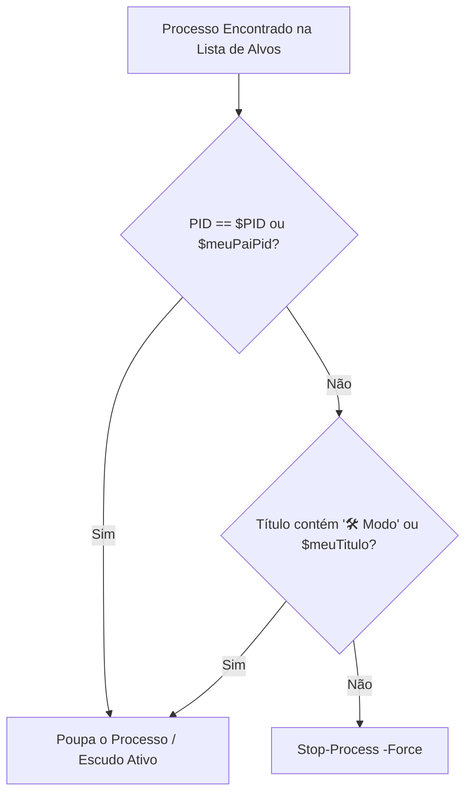

# 🏛️ Ciclo de Vida e Segurança de Processos

Detalhamento dos mecanismos de proteção de janelas, interop COM e tratamento de erros do sistema de automação.

---

## 1. Mecanismo de Escudo de Proteção

Para evitar que o script feche a própria janela de execução ou mate sessões administrativas abertas pelo operador, a rotina adota três camadas de blindagem:

1. **PID Próprio (`$PID`):** Impede autodestruição do terminal.
2. **PID Pai (`ParentProcessId` via WMI/CIM):** Protege o terminal pai (ex: Windows Terminal, VS Code ou Console Host que invocou o script).
3. **Escudo de Título (`🛠️ Modo`):** Permite fixar janelas sagradas que não devem ser fechadas mesmo que coincidam com nomes de processos alvos.

---

## 2. Encerramento Gracioso vs. Forçado do Office

Ao contrário de um simples `taskkill /f /im excel.exe`, o encerramento implementado preserva o trabalho do usuário:

1. **Inspeção de Documentos Sem Caminho Físico:** Se `[string]::IsNullOrEmpty($wb.Path)`, o documento foi recém-criado e nunca salvo. O script gera um nome único com timestamp em `Downloads\` e salva no formato oficial (`SaveAs` ou `SaveAs2` formato 16 `.docx`).
2. **Documentos com Caminho:** Dispara `$wb.Save()` direto.
3. **Desativação de Alertas:** `$excel.DisplayAlerts = $false` e `$word.DisplayAlerts = 0` evitam que caixas de diálogo modais travem a automação em segundo plano.
4. **Desalocação COM:** Liberação explícita através de `[System.Runtime.InteropServices.Marshal]::ReleaseComObject` para evitar processos fantasmas retidos pelo CLR.

