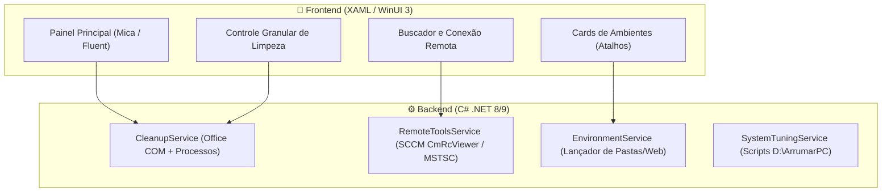

# 🏛️ Arquitetura do Hub Desktop: WinUI 3 + C#

Documentação técnica do projeto de interface desktop para orquestração de ambientes, automações de desempenho e lançador de ferramentas remotas.

---

## 1. Como funciona a relação WinUI 3 e C#?

- **XAML (Frontend / UI):** Linguagem declarativa similar a um HTML/XML. Nela desenhamos as janelas, botões, caixas de busca, abas e cartões de ambientes visuais com o Fluent Design do Windows 11.
- **C# (Backend / Lógica):** Código que roda por trás do clique dos botões. É onde residem:
  - As chamadas de processos (`Process.Start` para o executável do SCCM Remote Control, RDP, etc.).
  - A manipulação e listagem de processos ativos.
  - A interoperabilidade COM com o Microsoft Office para salvar arquivos.
  - A execução direta ou headless das rotinas de AD/PXE.



---

## 2. Principais Módulos do Sistema

### A. Módulo de Ambientes Virtuais (Atalhos)
Substitui os atalhos estáticos em `.lnk`/scripts soltos. O usuário seleciona o perfil desejado (ex: Atendimento, Suporte, Produção) e o app:
1. Aplica limpeza seletiva prévia.
2. Abre as abas do Edge pertinentes.
3. Abre as pastas de rede/locais agrupadas no Explorer.

### B. Módulo de Acesso Remoto Direto
1. **SCCM Remote Control (`CmRcViewer.exe`):** Em vez de abrir o pesado console do Configuration Manager, o app invoca diretamente o visualizador leve passando a máquina:
   ```csharp
   Process.Start("CmRcViewer.exe", $"{nomeMaquina} /v");
   ```
2. **Área de Trabalho Remota (`mstsc.exe`):** Conexão imediata via RDP.

### C. Módulo de Operações Headless (AD & PXE)
1. **Active Directory:** Consulta e desbloqueio de contas ou limpeza sem abrir `mmc.exe`.
2. **PXE / SCCM Cache:** Limpeza de registros de boot PXE e deployments sem carregar a interface gráfica lenta do console.

### D. Módulo de Limpeza e Performance (D:\ArrumarPC + biblioteca.ps1)
Painel com switches e botões para executar:
- Limpeza de Telemetria e serviços dispensáveis.
- Encerramento seguro de processos e salvamento Office.
- Limpeza de logs e arquivos temporários.

