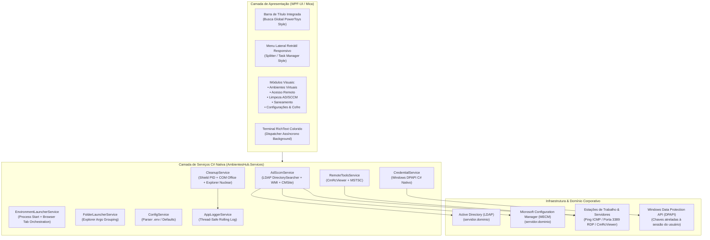

# 🏛️ Ambientes Hub — Automação Corporativa & Produtividade Windows

<div align="center">


**Central Unificada de Produtividade, Automação de Ambientes de Trabalho, Acesso Remoto Integrado e Saneamento de Recursos.**

[Central de Documentação (Docs)](Docs/README.md) • [Diretrizes de Engenharia (AGENTS.md)](AGENTS.md) • [Suíte de Testes (tests/)](tests/run_all.ps1) • [Manual do Hub Desktop](Docs/guias/guia_ambientes_hub_desktop.md)

</div>

---

## 📋 Sumário Executivo

- [1. Visão Geral](#-1-visão-geral)
- [2. Arquitetura do Sistema](#-2-arquitetura-do-sistema)
- [3. Módulos & Funcionalidades](#-3-módulos--funcionalidades)
  - [3.1 Central de Ambientes Virtuais & Modos de Trabalho](#31-central-de-ambientes-virtuais--modos-de-trabalho)
  - [3.2 Central de Acesso Remoto & Diagnóstico Integrado (AD, SCCM & Rede)](#32-central-de-acesso-remoto--diagnóstico-integrado-ad-sccm--rede)
  - [3.3 Barra de Título com Pesquisa Global Inteligente (PowerToys Style)](#33-barra-de-título-com-pesquisa-global-inteligente-powertoys-style)
  - [3.4 Desprovisionamento & Limpeza de Ativos (AD & SCCM)](#34-desprovisionamento--limpeza-de-ativos-ad--sccm)
  - [3.5 Saneamento de Recursos & Limpeza de Memória (Teams, Navegadores & Explorer Nuclear)](#35-saneamento-de-recursos--limpeza-de-memória-teams-navegadores--explorer-nuclear)
  - [3.6 Inicialização com Windows & Bandeja do Sistema (Tray Icon)](#36-inicialização-com-windows--bandeja-do-sistema-tray-icon)
  - [3.7 Cofre Seguro de Credenciais DPAPI & Configurações (.env)](#37-cofre-seguro-de-credenciais-dpapi--configurações-env)
  - [3.8 Terminal de Logs em Cores e Monitoramento em Tempo Real](#38-terminal-de-logs-em-cores-e-monitoramento-em-tempo-real)
  - [3.9 Escudo de Processos & Proteção de Segurança](#39-escudo-de-processos--proteção-de-segurança)
- [4. Estrutura de Diretórios](#-4-estrutura-de-diretórios)
- [5. Como Executar & Compilar](#-5-como-executar--compilar)
- [6. Suíte de Testes Automatizados (xUnit + Runner ANSI)](#-6-suíte-de-testes-automatizados-xunit--runner-ansi)
- [7. Central de Documentação Técnica](#-7-central-de-documentação-técnica)

---

## 🎯 1. Visão Geral

O **Ambientes Hub** é uma aplicação nativa Windows desenvolvida em **C# (.NET 8)** com interface moderna **WPF-UI (Fluent Design / Mica)**, criada para consolidar e acelerar as atividades operacionais diárias de suporte técnico, administração de ativos e desenvolvimento em ambientes corporativos Windows.

A plataforma unifica em uma única interface responsiva a transição instantânea de perfis de trabalho (com encerramento seguro de distrações e preservação transacional do Office), central profunda de diagnóstico e acesso remoto de computadores (AD, SCCM, ICMP e RDP), rotinas de saneamento de memória e cofre de senhas criptografado por hardware.

---

## 🏛️ 2. Arquitetura do Sistema

O sistema foi arquitetado com base no padrão MVVM/Services desacoplado, garantindo execução assíncrona multithreaded para que a interface permaneça a 60 FPS contínuos durante operações de rede intensivas:



---

## 🚀 3. Módulos & Funcionalidades

### 3.1 Central de Ambientes Virtuais & Modos de Trabalho

- **Modo Chamados:** Prepara o ambiente para atendimento e esteira de TI (SIMP, OTRS/CitSmart, planilhas corporativas, Teams e WhatsApp).
- **Modo Contratos:** Foco operacional na fiscalização de contratos, garantias SAJ e pastas de fornecedores.
- **Modo Impressoras:** Abertura do portal PaperCut MF, inventário de multifuncionais e relatórios de bilhetagem.
- **Modo PXE:** Carrega pastas de imagens WIM, scripts de bancada e ferramentas para formatação rápida.
- **Modo Estudo / Foco:** Ambiente blindado livre de distrações, com supressão de notificações e ferramentas de aprendizado.

### 3.2 Central de Acesso Remoto & Diagnóstico Integrado (AD, SCCM & Rede)

- **Pesquisa Ampla e Flexível:** Localiza ativos por parte do nome (ex: `80600`), nome completo (`DOMINIO-80600`), usuário conectado (`usuario.sobrenome`) ou endereço MAC.
- **Triangulação Completa em Tempo Real:**
  - **Sessão & Usuário:** Usuário logado ativamente (`CurrentLogonUser`), usuário primário cadastrado no SCCM, IP com medição de latência em milissegundos.
  - **Active Directory:** Sistema operacional, data de criação da conta de computador e Unidade Organizacional (OU) completa.
  - **Configuration Manager:** Status do agente do cliente (Ativo/Inativo), MAC Address, ResourceID e GUID SMSID.
- **Ações Rápidas de Conexão com 1 Clique:**
  - **Acessar CmRcViewer:** Conexão nativa do Configuration Manager Remote Control Viewer com fallback gracioso.
  - **Acessar RDP:** Disparo imediato do Cliente de Área de Trabalho Remota Oficial do Windows (`mstsc /v:HOST`).
  - **Botões de Cópia com 1 Clique:** Cópia rápida para o clipboard de Nome, Usuário, IP e MAC.

### 3.3 Barra de Título com Pesquisa Global Inteligente (PowerToys Style)

- **Roteamento Global Centralizado:** Integrada no cabeçalho não-cliente da janela com hit-testing nativo (`HTCLIENT`).
- **Navegação por Comandos:** Digitar termos de módulos (`chamados`, `saneamento`, `configurações`, `ad`) navega imediatamente para a aba correspondente.
- **Busca Global Direta:** Digitar o número ou nome de uma máquina ou usuário dispara automaticamente a pesquisa de diagnóstico na aba de Acesso Remoto.

### 3.4 Desprovisionamento & Limpeza de Ativos (AD & SCCM)

- **Exclusão Transacional de Máquinas:** Remove com segurança o objeto de computador no Active Directory (`DeleteTree`) e no banco de dados do Configuration Manager (via WMI nativo ou provedor CMSite).
- **Caixa de Confirmação Crítica:** Exige confirmação explícita do operador antes de qualquer remoção de ativo do parque.

### 3.5 Saneamento de Recursos & Limpeza de Memória (Teams, Navegadores & Explorer Nuclear)

- **Encerramento Transacional do Office (COM):** Inspeciona ativamente Excel e Word via COM API, salva planilhas e documentos alterados antes de finalizar, liberando ponteiros COM (`Marshal.ReleaseComObject`).
- **Limpeza de Caches Pesados:** Encerra instâncias de navegadores (Edge, Chrome, Firefox) e o Microsoft Teams.
- **Supressão de Telemetria:** Neutraliza processos de coleta de métricas em segundo plano (`CompatTelRunner`).
- **Modo Nuclear do Explorer:** Encerramento seguro do `explorer.exe`, expurgo de cache de ícones/miniaturas bloqueados e reinício limpo do shell do Windows em C# nativo.

### 3.6 Inicialização com Windows & Bandeja do Sistema (Tray Icon)

- **Boot & Logon Automático:** Opção ativada diretamente no painel de configurações para iniciar o Ambientes Hub junto com o Windows via registro (`HKCU\...\Run`).
- **Atalho no Menu Iniciar:** Criação/remoção com um clique do atalho `.lnk` com ícone oficial na lista de programas do usuário (`Environment.SpecialFolder.Programs`).
- **Bandeja do Sistema (Tray):** Ícone oficial na área de notificação perto do relógio com suporte a balões informativos, duplo clique para restaurar a janela e menu de contexto com opções para abrir ou encerrar o aplicativo.
- **Identidade Visual no Gerenciador de Tarefas:** Metadados e ícone integrados no binário com título oficial e identidade corporativa.

### 3.7 Cofre Seguro de Credenciais DPAPI & Configurações (.env)

- **Criptografia DPAPI de Alta Segurança:** Senhas criptografadas usando a API de Proteção de Dados do Windows (`DataProtectionScope.CurrentUser`), garantindo que o cofre só possa ser lido na sessão do próprio operador.
- **Zero Credenciais Hardcoded:** Todas as chaves e nomes administrativos são gerenciados pelo arquivo `.env` local (com `.env.example` versionado para referência).

### 3.7 Terminal de Logs em Cores e Monitoramento em Tempo Real

- **Colorização Sintática Automática:** Destaque em tempo real de mensagens de sucesso (Emerald 400), erros/falhas (Red 400), avisos (Amber 400) e etapas de progresso (Sky 400).
- **Assincronismo Total:** Despacho de logs em prioridade `Background` para evitar bloqueios ou atrasos na interface visual.

### 3.8 Escudo de Processos & Proteção de Segurança

- **Imunidade de PIDs:** O próprio processo do `AmbientesHub` e seu processo-pai (terminal/launcher) são imunes a encerramento nas rotinas de limpeza.
- **Escudo por Título `"🛠️ Modo"`:** Qualquer janela ou aplicativo ativo pertencente a um modo de trabalho ativo é preservado contra encerramentos acidentais.

---

## 🗂️ 4. Estrutura de Diretórios

```text
AmbientesVirtuais/
├── AmbientesHub/                             # Aplicação Desktop Principal (C# .NET 8 WPF-UI)
│   ├── AmbientesHub.csproj                   # Configurações do projeto e dependências NuGet
│   ├── App.xaml / App.xaml.cs                # Inicializador da aplicação e recursos visuais Fluent
│   ├── MainWindow.xaml / .xaml.cs            # Janela principal com Mica, Splitter, TitleBar e Abas
│   │
│   ├── Assets/                               # Ícones e logotipos vetoriais do sistema
│   │   ├── app.ico                           # Ícone oficial de alta resolução
│   │   └── app.svg                           # Versão vetorial
│   │
│   ├── Models/                               # Modelos de dados e contratos
│   │   ├── MachineDetails.cs                 # Ficha completa da máquina (AD, SCCM, IP, Status)
│   │   └── EnvironmentConfig.cs              # Opções e perfis de saneamento
│   │
│   ├── Services/                             # Camada de serviços autônomos em C#
│   │   ├── AdSccmService.cs                  # Conexão híbrida AD LDAP + SCCM WMI/CMSite + Ping
│   │   ├── RemoteToolsService.cs             # Orquestrador do CmRcViewer e RDP Oficial (mstsc)
│   │   ├── CleanupService.cs                 # Saneamento de memória, COM Office e Explorer Nuclear
│   │   ├── EnvironmentLauncherService.cs     # Inicializador de modos e automação de navegadores
│   │   ├── FolderLauncherService.cs          # Disparador agrupado de diretórios do Windows
│   │   ├── CredentialService.cs              # Gerador e validador nativo de cofre DPAPI
│   │   ├── ConfigService.cs                  # Carregamento e sincronização com arquivo .env
│   │   ├── AppLoggerService.cs               # Sistema de logs com rotação e gravação em disco
│   │   └── ClipboardHelper.cs                # Utilitário com retry para a Área de Transferência
│   │
│   ├── Views/                                # Janelas de diálogo e modais auxiliares
│   │   └── CredentialDialog.xaml / .xaml.cs  # Formulário Fluent para criação segura de credenciais
│   │
│   └── logs/                                 # Logs operacionais da aplicação
│       └── app.log                           # Histórico de execuções com timestamp
│
├── tests/                                    # Suíte Unificada de Testes Automatizados (xUnit)
│   ├── AmbientesHub.Tests.csproj             # Projeto de testes .NET 8 referenciando AmbientesHub
│   ├── run_all.ps1                           # Script runner interativo com banner ANSI e medição
│   ├── Unit/                                 # Testes unitários (Models, Config, Logger, DPAPI)
│   ├── Services/                             # Testes de serviços (RemoteTools, Clipboard)
│   └── Integration/                          # Testes de integração (Escudo de PIDs, Auditoria SecOps)
│
├── Credenciais/                              # Diretório dos cofres DPAPI protegidos (ignorado no git)
│   ├── cred_admin.xml                        # Credencial do administrador local
│   └── cred_admin_ad.xml                     # Credencial do administrador do domínio
│
├── Docs/                                     # Central Unificada de Documentação Técnica
│   ├── README.md                             # Índice central e navegação da documentação
│   ├── arquitetura/                          # Decisões de arquitetura de software e COM
│   ├── guias/                                # Manuais do Hub, testes e operação de rotinas
│   └── issues/                               # Checklist de homologação e validações
│
├── AGENTS.md                                 # Diretrizes mandatórias para agentes de IA e engenharia
├── .env.example                              # Modelo seguro de variáveis de ambiente do sistema
└── README.md                                 # Este arquivo
```

---

## 📦 5. Como Executar & Compilar

### Pré-requisitos

- **Sistema Operacional:** Windows 10 (Build 19041+) ou Windows 11.
- **Ambiente de Desenvolvimento:** [.NET 8.0 SDK](https://dotnet.microsoft.com/download/dotnet/8.0) instalado.
- **Permissões:** Executar com usuário padrão ou administrador para rotinas de sistema.

### 1. Clonar e Configurar o Ambiente

```powershell
cd C:\AmbientesVirtuais
Copy-Item .env.example AmbientesHub\.env
```

### 2. Executar a Aplicação Desktop

#### Via .NET CLI (Desenvolvimento / Debug):

```powershell
dotnet run --project C:\AmbientesVirtuais\AmbientesHub\AmbientesHub.csproj
```

#### Via Executável Nativo Compilado (.exe):

```powershell
Start-Process "C:\AmbientesVirtuais\AmbientesHub\bin\Debug\net8.0-windows\AmbientesHub.exe"
```

### 3. Publicar Executável para Uso e Distribuição

Existem duas formas de publicação dependendo do cenário de distribuição:

#### Opção A: Executável Autocontido e Portátil (Roda em Qualquer PC sem .NET Instalado)

Empacota o runtime do .NET 8 e todas as dependências em um executável autônomo. Ideal para rodar em qualquer máquina de suporte, máquinas de bancada ou direto de um pendrive:

```powershell
dotnet publish C:\AmbientesVirtuais\AmbientesHub\AmbientesHub.csproj -c Release -r win-x64 --self-contained true -p:PublishSingleFile=true -o C:\AmbientesVirtuais\AmbientesHub\bin\Portatil
```

_Binário pronto em: `C:\AmbientesVirtuais\AmbientesHub\bin\Portatil\AmbientesHub.exe`._

#### Opção B: Framework-Dependent (Executável Leve)

Para máquinas corporativas que já possuem o _.NET Desktop Runtime 8.0_ instalado (distribuído via SCCM/Intune):

```powershell
dotnet publish C:\AmbientesVirtuais\AmbientesHub\AmbientesHub.csproj -c Release -r win-x64 --self-contained false -o C:\AmbientesVirtuais\AmbientesHub\bin\Publish
```

_Binário pronto em: `C:\AmbientesVirtuais\AmbientesHub\bin\Publish\AmbientesHub.exe`._

---

## 🧪 6. Suíte de Testes Automatizados (xUnit + Runner ANSI)

O repositório conta com política de integridade contínua: **qualquer modificação no código-fonte exige 100% de sucesso na suíte de testes (0 falhas, 0 erros)**.

### Executar via Runner Interativo (Recomendado)

Apresenta banner visual com cronômetro de precisão e relatório formatado:

```powershell
pwsh -File C:\AmbientesVirtuais\tests\run_all.ps1
```

### Executar via .NET CLI Nativa

```powershell
dotnet test C:\AmbientesVirtuais\tests\AmbientesHub.Tests.csproj
```

---

## 📚 7. Central de Documentação Técnica

Para guias aprofundados, diagramas conceituais e detalhamento de cada rotina técnica, consulte:

- **[Índice Central de Documentação (Docs/README.md)](Docs/README.md)**
- **[Arquitetura de Segurança & Hardening (SecOps)](Docs/arquitetura/seguranca_hardening.md)**
- **[Manual da Suíte de Testes Automatizados](Docs/guias/suite_testes_automatizados.md)**
- **[Guia Operacional do Ambientes Hub Desktop](Docs/guias/guia_ambientes_hub_desktop.md)**
- **[Análise Arquitetural: C# Nativo vs PowerShell](Docs/arquitetura/analise_arquitetural_powershell_vs_csharp.md)**
- **[Ciclo de Vida de Processos & Segurança COM do Office](Docs/arquitetura/ciclo_de_vida_e_seguranca_processos.md)**
- **[Diretrizes de Engenharia para Agentes (AGENTS.md)](AGENTS.md)**
